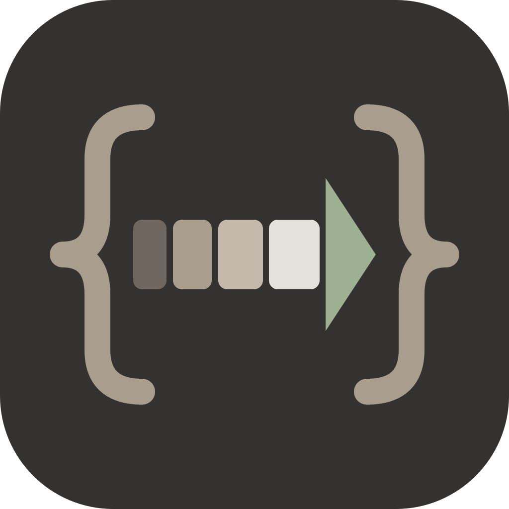

# Sendix

Cliente de API de escritorio, local primero y compatible con colecciones Postman v2.1. Sistema visual en [docs/DESIGN.md](docs/DESIGN.md).

**¿Primera vez?** Empieza por la [guía rápida](docs/GUIA-RAPIDA.md) (también en [protohub.digital/sendix/guia](https://protohub.digital/sendix/guia/)). Cada función se explica en el [manual de uso](docs/MANUAL.md).

Estado: **0.3.1**. Están completos los hitos de la 1.0 (HTTP, WebSocket/Socket.IO y gRPC), los de la 0.2 (ajustes y tema, visor de respuesta, ejecutor de colecciones y red) y la integración con Mockix.

**Peticiones (M1)**
- Editor de peticiones:
  - método y URL, sincronizada con la tabla de parámetros;
  - autorización Bearer, básica, clave de API, heredada, o conservada desde el archivo;
  - cabeceras;
  - cuerpo JSON/texto/XML, x-www-form-urlencoded o form-data de texto;
  - ajustes: tiempo máximo, redirecciones y verificación TLS.
- Envío desde el motor con `postman-runtime`, sin cabeceras de rastreo y con `User-Agent: Sendix/<versión>`.
- Visor de respuesta: estado, estratos de tiempos, cuerpo, imágenes, cabeceras, cookies y la petición real enviada.
- Historial en SQLite (`node:sqlite`), sin cuerpos de respuesta y **sin credenciales**.

**Carpeta de trabajo (M2)**
- Una carpeta tuya, lista para git:
  - `sendix.workspace.json`;
  - `collections/*.postman_collection.json` en formato v2.1;
  - `environments/*.postman_environment.json`.
- **Sin pérdidas:** al guardar, Sendix solo reescribe lo que cambió (método, URL, cabeceras, cuerpo, autorización, scripts y dos ajustes). Los ejemplos, las descripciones y las autorizaciones o cuerpos que aún no edita (OAuth 2.0, GraphQL, archivos…) se conservan tal cual y se envían igual. Guardar una petición sin cambios deja el archivo idéntico.
- Árbol de colecciones con carpetas: nueva petición o carpeta, renombrar, duplicar y eliminar. `Ctrl S` guarda; una petición nueva pide colección y carpeta.
- **Variables:**
  - `{{variables}}` de entorno y de colección; las del entorno tienen prioridad, como en Postman;
  - se resaltan en la URL (en rojo si no tienen valor);
  - se resuelven en la vista previa;
  - la autorización y las variables se heredan de la colección y de cada carpeta.
- **Secretos:** las variables secretas se cifran con el sistema operativo (`safeStorage`, DPAPI en Windows) en el perfil del usuario y **nunca se escriben en la carpeta**. La interfaz no recibe nunca su valor; el proceso principal lo añade solo al enviar.
- **Importar:**
  - colecciones de Postman v2.0/v2.1 y entornos;
  - OpenAPI 3/Swagger 2 en JSON o YAML, convertido en el motor aislado;
  - capturas HAR, de las que se quitan las cookies y las cabeceras `Authorization`;
  - pegar un comando `curl` en la URL lo convierte en la petición.

**Scripts y tests (M3)**
- Scripts **antes de la petición** y **después de la respuesta** con la API `pm.*` de Postman (`pm.test`, `pm.expect`, `pm.response`, `pm.environment`, `pm.collectionVariables`, `pm.iterationData`, `pm.sendRequest`…), ejecutados por `postman-runtime` en el motor aislado.
  - Editor CodeMirror con resaltado, autocompletado de `pm.*` y de nombres de variables, y fragmentos frecuentes.
  - Los scripts de la colección y de cada carpeta se ejecutan antes que los de la petición, como en Postman.
  - Si el script de antes de la petición falla, la petición no se envía.
- Pestañas **Tests** (pasa/falla con el motivo) y **Consola** (`console.log`, `warn`, `error`) en la respuesta.
- **Variables de sesión:** lo que guardan `pm.environment.set` y `pm.collectionVariables.set` se usa en las siguientes peticiones, pero dura solo hasta cerrar Sendix y **no se escribe en los archivos**. La barra de estado avisa cuando hay valores de sesión y permite olvidarlos.
- Los valores de las variables secretas se ocultan (`••••••••`) en la consola y en los mensajes de los tests.
- **Ejecutor de colecciones:** ejecuta una colección o una carpeta en orden, con iteraciones, retraso entre peticiones y un archivo de datos **CSV o JSON** (cada fila alimenta una iteración: `{{columna}}` o `pm.iterationData.get("columna")`). Muestra el progreso, los tests y el detalle de cada petición, con filtro de fallos.
- Aún no se admiten `pm.execution.setNextRequest` / `postman.setNextRequest` en el ejecutor: el orden es siempre el de la colección.

**Tiempo real (M4)**
- Conexiones **WebSocket** (`ws`) y **Socket.IO** (`socket.io-client`, servidores v3 y v4) desde el selector de método de una pestaña nueva.
  - WebSocket: cabeceras, subprotocolos, mensajes de texto y binarios, códigos de cierre explicados.
  - Socket.IO: ruta del servidor, `auth` del saludo en JSON, cualquier evento recibido y `emit` con evento y *ack*.
- Registro de mensajes enviados y recibidos con hora, tamaño, filtro, búsqueda y detalle (JSON formateado o volcado hexadecimal).
- `{{variables}}` en la URL, las cabeceras, `auth` y los mensajes, resueltas al conectar y al enviar; los secretos se ocultan en el registro.
- Reconexión opcional con espera creciente cuando la conexión se corta (nunca si la cierras tú) y tabla de las últimas conexiones.
- Mensajes guardados por conexión. Las conexiones se guardan en la colección como items v2.1 con `request` (URL y cabeceras) y un campo `x-sendix` que otras herramientas ignoran.
- Si el motor se reinicia, las conexiones abiertas se cierran en la interfaz con un aviso en vez de quedarse colgadas.

**gRPC (M5)**
- Llamadas con `@grpc/grpc-js` y `protobufjs` desde el selector de protocolo: **unarias, stream del servidor, stream del cliente y bidireccionales**.
- Definición por **reflexión del servidor** (v1 y v1alpha) o con **archivos `.proto`** y rutas de importación; los tipos de Google (`Timestamp`, `Any`…) vienen incluidos.
- Lista de servicios y métodos con sus tipos, **mensaje de ejemplo** generado desde el esquema y comprobación de campos antes de llamar (un campo que no existe no se descarta en silencio).
- Metadatos (también `-bin` en base64), TLS verificado, TLS sin verificar para pruebas, **mTLS** con CA, certificado y clave propios, y *deadline*.
- Respuesta con el estado gRPC explicado, cabeceras, *trailers* y el registro de mensajes de los streams.
- `{{variables}}` en la dirección, los metadatos y los mensajes.
- Se guardan en la colección como items v2.1 con campo `x-sendix`.

**Instalador y actualizaciones (M6)**
- Logo: la barra de tiempos de Sendix terminada en una flecha de envío, entre llaves, sobre la piedra oscura de protohub. Se genera con `python -I build/logo.py` (`build/icon.png`, `build/icon.ico` y `docs/logo.svg`).
- Instalador NSIS por usuario (sin permisos de administrador), con carpeta elegible y acceso directo. El `.exe` lleva icono y datos de versión, y el renderer va minificado.
- **Actualizaciones automáticas** con `electron-updater` desde las versiones publicadas en GitHub: la versión instalada busca unos segundos después de arrancar y cuando se lo pides en la pestaña Sistema, descarga en segundo plano y se instala al reiniciar (botón «Reiniciar para actualizar») o al cerrar. Las compilaciones de desarrollo nunca se actualizan.
- **Publicar una versión:** sube la versión en `package.json` y crea la etiqueta `vX.Y.Z`. El flujo `.github/workflows/release.yml` comprueba que la etiqueta coincide, ejecuta `npm run check`, genera el instalador y deja un borrador de release con el `.exe`, su `.sha256`, el `.blockmap` y `latest.yml`. Tiene un paso de firma con SignPath que solo se ejecuta si existe el secreto `SIGNPATH_API_TOKEN`.

**Ajustes y tema (0.2, U1)**
- Pantalla **Ajustes** en la barra lateral o con `Ctrl ,`. Se guarda en `settings.json` del perfil y se aplica al momento.
- **Tema:** Sistema (sigue a Windows), Claro u Oscuro. Lo aplica Electron (`nativeTheme.themeSource`), así que la barra de título nativa y la interfaz cambian juntas.
- **Editor de código:** tamaño de letra (también en las respuestas), sangría de 2 o 4 espacios y cierre automático de llaves y comillas.
- **Peticiones:**
  - tiempo máximo para peticiones nuevas y para las guardadas al abrirlas o ejecutarlas;
  - tamaño máximo de respuesta;
  - interruptores globales de verificación TLS y de redirecciones. Solo pueden desactivar: con la verificación apagada, ninguna conexión HTTP, WebSocket, Socket.IO ni gRPC la hace;
  - cabecera `Cache-Control: no-cache` opcional.

  Los aplica el proceso principal, así que valen también para el ejecutor de colecciones.
- **Datos de este equipo:** carpeta del perfil, borrar el historial y acceso al estado del sistema.

**Visor de respuesta (0.2, U2)**
- **Visor de CodeMirror de solo lectura:**
  - pliega objetos, arreglos y etiquetas;
  - busca con `Ctrl F` o con su botón, con mayúsculas, expresiones regulares y palabra completa;
  - pone números de línea;
  - solo pinta las líneas visibles, así que ya no hay corte de 20 000 líneas. Por encima de 5 MB se muestra sin colores para que el desplazamiento siga fluido.
- **Filtro:**
  - JSONPath (`jsonpath-plus` en modo `safe`, sin `eval`, compatible con la CSP) para JSON;
  - XPath (el evaluador del propio navegador) para XML;
  - muestra el número de resultados o el error, y el botón de copiar copia el resultado filtrado.
- **Formatos:** XML indentado y **formato forzado**: Automático, JSON, XML, HTML o Texto.
- **Vista previa de HTML** en un `iframe` con `sandbox` servido por el proceso principal (`app://sendix/__preview/…`):
  - con su propia CSP, que solo permite estilos en línea e imágenes `data:`;
  - sin scripts y sin red, y la navegación fuera de la app está bloqueada.

**Ejecutor de colecciones (0.2, U3)**
- **Elegir y ordenar:** casillas por petición (Todas / Ninguna) y botones para subir o bajar; «Orden de la colección» lo restablece.
- **Opciones:**
  - detener en el primer fallo (sin respuesta, test que falla o script con error);
  - guardar las variables al terminar: lo que los scripts dejan en el entorno activo y la colección se escribe en los archivos, y los secretos siguen cifrados;
  - conservar las respuestas (cabeceras y hasta 256 KB de cuerpo por fila, solo en memoria);
  - guardar o no la salida de consola.
- **Cookies:** el motor tiene un único almacén de cookies para todos los envíos, como un navegador. Una ejecución puede usarlo o **empezar sin cookies** con uno propio, y al final añadir sus cookies al de Sendix o descartarlas.
- **Historial de ejecuciones** en `sendix.db`: las 50 últimas, con hasta 5 000 filas cada una. Se pueden **ver**, **repetir** con la misma selección y opciones, **exportar a JSON** o borrar. Los archivos de datos de más de 1 MB no se guardan; al repetir se piden de nuevo.

**Red y certificados (0.2, U4)**
- **Proxy** para peticiones HTTP:
  - sin proxy;
  - del sistema: Electron resuelve el proxy de Windows para cada URL, PAC incluido;
  - propio: servidor, usuario y contraseña cifrada con `safeStorage`, más una lista de excepciones (nombres exactos, `*.dominio` o `.dominio`).
- **CA propia** (PEM): se confía en ella además de en las del sistema.
- **Certificados de cliente por host y puerto:** CRT + KEY o PFX/P12, con contraseña cifrada. Solo se envían al host y puerto configurados.
- **Cómo llegan los archivos al motor:**
  - las rutas solo se aceptan si se eligieron en un diálogo del proceso principal;
  - el proceso principal lee los archivos y el motor los recibe en memoria a través de un lector que no conoce otra cosa.
- **Errores de certificado explicados:** CA desconocida, autofirmado, caducado, nombre que no coincide, certificado de cliente requerido… Con dos acciones rápidas: «Reenviar sin verificar esta petición» o ir a Ajustes.
- **Ajustes avanzados por petición** guardados en `protocolProfileBehavior` (v2.1), cada uno con «Heredar», «Sí» o «No»:
  - máximo de redirecciones;
  - método original al redirigir;
  - Authorization al redirigir;
  - quitar Referer;
  - URL sin codificar;
  - sin cookies.

  «Heredar» toma el valor de la carpeta o la colección: el motor envuelve la petición con el `protocolProfileBehavior` de cada nivel.

**0.2.1**
- El cuerpo de la petición usa el editor de código: resalta JSON, XML, HTML y JavaScript, marca las `{{variables}}` y respeta la sangría de Ajustes.
- El divisor entre la petición y la respuesta se arrastra (entre el 25 % y el 75 % del ancho). Se guarda en Ajustes, admite flechas del teclado y con doble clic vuelve al original.

**Integración con Mockix**
- **`sendix://` (de Mockix a Sendix):** el botón «Sendix» del editor de rutas de Mockix («Abrir esta petición en Sendix») abre `sendix://request?method=…&url=…[&headers=<JSON>][&body=…]`.
  - **Registro:** el instalador lo registra para el usuario (`build/installer.nsh`) y la app lo vuelve a registrar al arrancar empaquetada (`app.setAsDefaultProtocolClient`) y, si algo lo quitó, al recibir el foco. Al desinstalar, el registro solo se borra si sigue apuntando a esa instalación; una actualización no lo borra.
  - **Llegada del enlace en Windows:** si Sendix ya está abierto, llega por el `argv` de la segunda instancia (instancia única); si lo arranca el enlace, por su propio `argv`.
  - **Validación (zod, `src/shared/links.ts`):**
    - métodos GET, POST, PUT, PATCH, DELETE, HEAD u OPTIONS;
    - URL `http(s)`;
    - hasta 50 cabeceras con nombres válidos;
    - cuerpo de hasta 64 KB;
    - sin parámetros repetidos.

    Un enlace inválido se descarta sin preguntar.
  - **Confirmación:** Sendix muestra la petición (método, URL, cabeceras y cuerpo). Solo si la aceptas la abre en una **pestaña nueva sin guardar**; nada se envía hasta que pulsas Enviar.
- **«Crear mock desde esta colección» (de Sendix a Mockix):** está en el menú de cada colección y solo aparece si Mockix registró `mockix://` en el equipo (`app.getApplicationNameForProtocol`).
  - Abre `mockix://import?collection=<archivo .json>` con `shell.openExternal`. El archivo es el v2.1 de la carpeta de trabajo, ya guardado en disco.
  - Añade `&workspace=<carpeta>` solo si esa carpeta es también un workspace de Mockix (tiene `mockix.workspace.yaml`); si no, Mockix importa en el workspace que tenga abierto.
  - Mockix valida el enlace y pide confirmación antes de importar.

## Requisitos

- Node.js 22.12 o superior (probado con 24.22) y npm 11.
- Windows 10/11 x64 para empaquetar.

```bash
npm install
```

npm 11 bloquea los scripts de instalación que no están aprobados. `package.json` → `allowScripts` aprueba el de `electron`, que descarga el binario, y deniega el de `electron-winstaller`, que no se usa porque el instalador es NSIS.

## Scripts

| Script | Qué hace |
|---|---|
| `npm run dev` | App con recarga en caliente (servidor de Vite y CSP de desarrollo) |
| `npm run build` | Compila main, motor, preload y renderer en `out/` |
| `npm run start` | Ejecuta la compilación de `out/` |
| `npm run typecheck` | TypeScript estricto en los tres proyectos: node, web y e2e |
| `npm test` | Tests unitarios (Vitest) |
| `npm run test:e2e` | Compila y arranca Electron real con Playwright |
| `npm run check` | Todo lo anterior |
| `npm run dist` | Instalador NSIS y `latest.yml` en `release/<versión>/` |

## Arquitectura

```
src/
├─ main/       proceso principal: ventana, protocolo app://, seguridad, host del motor, router IPC
├─ engine/     utilityProcess: gestor de proveedores (manifiestos), servidor RPC, proveedores
├─ preload/    puente mínimo window.sendix (sandbox + contextIsolation)
├─ renderer/   React 19, tokens del diseño aprobado, fuentes autoalojadas
└─ shared/     contratos zod: sobres RPC (rpc.ts), métodos (methods.ts), canales IPC (ipc.ts)
```

Una llamada recorre este camino:

1. `window.sendix.engine.call(método, params)`
2. El main comprueba el remitente, que el método esté en `methods.ts` y los parámetros (zod).
3. La llamada viaja por un MessagePort hasta el motor.
4. El motor vuelve a validar y ejecuta el proveedor.
5. El motor valida el resultado y el main lo valida otra vez antes de devolverlo.

Errores siempre como `{ ok: false, error: { code, message } }`, nunca excepciones.

**Proveedores.** Para añadir uno, crea `src/engine/providers/<nombre>.ts` con su manifiesto (`name`, `methods`, `dependsOn`), regístralo en `src/engine/index.ts` y declara sus métodos con contratos en `src/shared/methods.ts`.

**Motor resistente.** Si el motor muere, el main lo reinicia con espera creciente (250 ms → 5 s). Las llamadas pendientes reciben `ENGINE_EXITED`. Si cae más de 5 veces en 60 s, queda en estado `failed`.

## Seguridad (verificada)

| Medida | Cómo se comprueba |
|---|---|
| `contextIsolation`, `sandbox`, sin `nodeIntegration`, sin `webviewTag` | E2E lee las preferencias aplicadas |
| UI servida desde `app://sendix` con CSP estricta (`default-src 'none'`, sin `unsafe-eval`) | E2E: `eval` bloqueado y origen correcto |
| Sin ventanas emergentes ni navegación fuera de la app; todos los permisos web denegados | E2E: `window.open` y cambio de `location` |
| Scripts de colecciones ejecutados solo en el motor (`utilityProcess`), con 30 s de tiempo máximo por script; la interfaz recibe resultados ya validados con zod y con los secretos ocultos | unitarios del proveedor HTTP |
| El motor solo lee los `.proto` y certificados que eliges en un diálogo o que usa una llamada gRPC guardada en la carpeta de trabajo | E2E: una ruta no elegida se rechaza con `FORBIDDEN` |
| La vista previa de HTML no ejecuta scripts ni pide nada a la red (iframe con `sandbox`, CSP propia y navegación de subframes bloqueada) | E2E: el script no corre y la imagen externa no se pide |
| El motor solo lee la CA y los certificados de cliente elegidos en un diálogo de Ajustes, y los recibe en memoria; las contraseñas del proxy y de los certificados se cifran y nunca llegan a la interfaz | E2E: CA, mTLS y proxy con autenticación contra servidores locales de prueba |
| Los enlaces `sendix://` se validan con zod y solo abren una pestaña tras confirmarlo; los inválidos se descartan | unitarios del parseo + E2E (enlace con la app abierta, al arrancar e inválido) |
| El editor de código vive en un shadow root con hojas de estilo construidas: la CSP sigue sin permitir estilos en línea | E2E: el editor se ve con sus estilos con la CSP de producción |
| IPC solo desde el marco principal de la app; métodos de prueba solo con `SENDIX_TEST=1` en builds sin empaquetar | E2E + unitarios |
| Rutas de `app://` sin escapar de la carpeta del renderer | unitarios (incluye `..%5c`) |
| Fuses empaquetados: RunAsNode, NODE_OPTIONS e `--inspect` desactivados; integridad del asar y solo `app.asar` activados; cookies cifradas; sin privilegios extra de `file://` | Lectura de los bytes de fuses del `Sendix.exe` empaquetado |
| Integridad del asar aplicada | Un `app.asar` modificado no arranca (sale con 0x80000003) |

## Problemas conocidos

- **Dependencias de `postman-runtime` con avisos de `npm audit`** (handlebars, faker, node-forge, qs, uuid). Son transitivas y no tienen arreglo sin forzar versiones incompatibles. Se ejecutan solo dentro del motor aislado. Revisar en cada actualización de `postman-runtime`; se fijó la 7.56.1, la más reciente con más de dos semanas.
- **El instalador no está firmado.** Windows SmartScreen puede avisar al ejecutarlo la primera vez («Más información» → «Ejecutar de todas formas»). Comprueba antes el SHA-256 publicado junto al instalador.
- El paso de electron-builder que escribe el icono y la versión en `Sendix.exe` fallaba en algunos equipos con `UNKNOWN: unknown error, open …\Sendix.exe` (un bloqueo breve del archivo recién escrito). Por eso ese paso está desactivado (`signAndEditExecutable: false`) y lo hace `build/after-pack.cjs` antes de aplicar los fuses, reintentando mientras el archivo siga bloqueado.

## Cómo se desarrolla

Sendix lo diseña y dirige Luis E. Bautista. El código, los tests y la documentación se escriben con la ayuda de Claude (Anthropic) como asistente de programación. Cada cambio se revisa y se prueba antes de integrarlo.

## Licencia

MIT. Ver [LICENSE](LICENSE).
